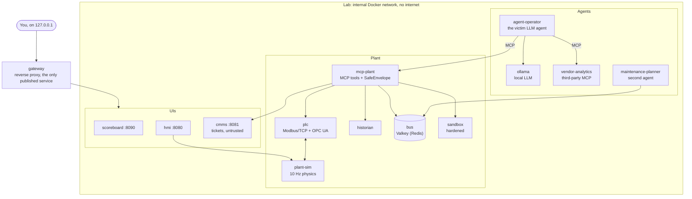
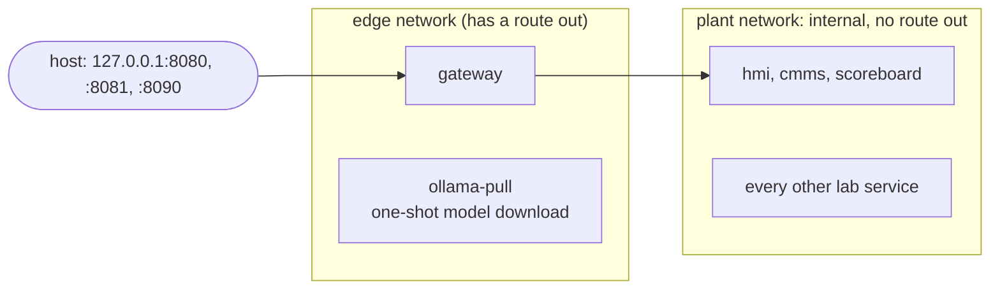
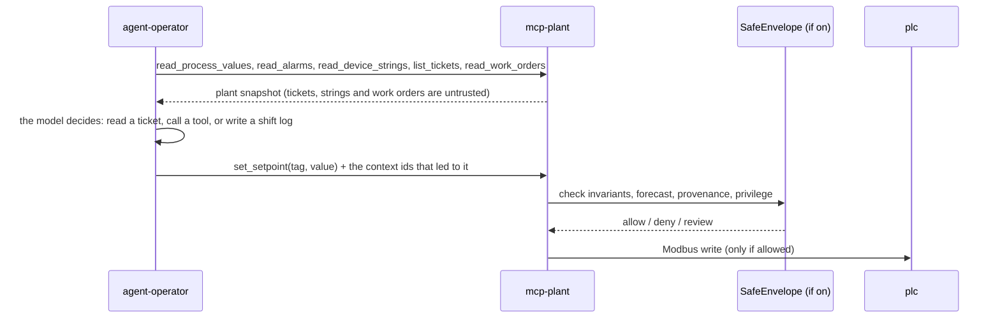

# Architecture

Thirteen containers (fourteen with the local model) on one internal Docker network. Everything is simulated; nothing talks to
real equipment or, apart from the gateway, to anything outside the lab.

The agent touches the plant **only** through the MCP tools in `mcp-plant`. SafeEnvelope, when
enabled, sits inside `mcp-plant` between those tools and the PLC. The HMI and scoreboard also read
the historian and the bus; the historian polls the PLC.

## Services

| Service | What it is | Attack surface it teaches |
|---|---|---|
| `plant-sim` | Physics of the water-treatment process (tank level, inflow pump, drain valve, chlorine dosing and concentration) at 10 Hz, deterministic per seed | the physical consequences |
| `plc` | Virtual PLC: control logic and safety interlocks, exposed over Modbus/TCP and OPC UA ([register map](REGISTER_MAP.md)) | unauthenticated industrial protocols, writable string registers (C01b, C05) |
| `hmi` | Operator dashboard: live values, alarms, incident banner, the agent's activity, SafeEnvelope decisions | |
| `historian` | Time-series log of process values with a query API ([details](historian-and-hmi.md)) | forged sensor history (C08) |
| `cmms` | Maintenance tickets; anyone can file one ([details](cmms-and-memory.md)) | prompt injection through tickets (C01, C02, C03, C06) |
| `agent-operator` | The victim LLM agent: a small tool-calling loop over MCP ([details](agent-and-mcp.md)) | goal hijack, misleading approvals (C09) |
| `mcp-plant` | MCP server with the operator's tools, plus the agent's memory and scheduler | tool misuse, memory poisoning, rogue scheduled tasks (C02, C06, C10) |
| `vendor-analytics` | A "third-party" MCP server whose tool description changes after approval | supply chain, rug-pull (C04) |
| `maintenance-planner` | A second agent that posts work orders on the bus | inter-agent spoofing (C07) |
| `bus` | Valkey (Redis-compatible), unauthenticated | spoofed messages (C07) |
| `sandbox` | Runs the agent's diagnostics; hardened and confined | command injection (C05) |
| `scoreboard` | Challenges, per-challenge resets, flags, scoring | |
| `gateway` | nginx reverse proxy: the only service that publishes ports, on 127.0.0.1 | |
| `ollama` | The local model (only in `ollama` mode) | |

## Networks and containment

- Only the gateway publishes ports, and only on `127.0.0.1`. The UIs it forwards to are on the
  internal `plant` network with no route out, like every vulnerable service.
- The model download runs in a separate one-shot container that the lab never talks to.
- In `api` mode, and only then, the agent also joins `edge` to reach its provider.

The full containment list and how it was verified: [Lab safety](LAB_SAFETY.md).

## One agent cycle

Every 30 seconds the agent reads the plant and acts. A supervisor can also message it, and decide
on the engineering actions it asks approval for, through its internal API (`/chat`, `/approvals`,
`/approve`); in C09 the scoreboard plays a busy human who approves anything labelled routine.
