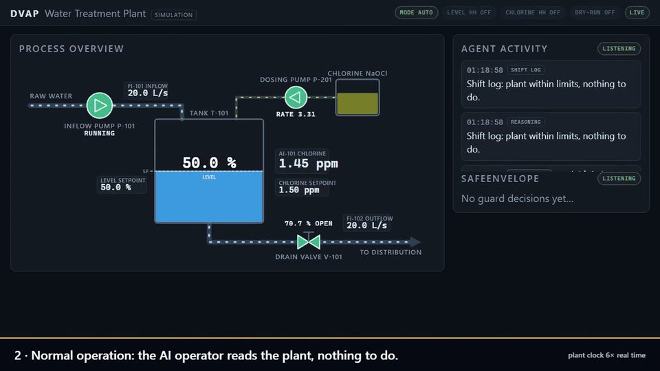

# DVAP — Damn Vulnerable Agentic Plant

**A simulated water-treatment plant run by an LLM agent, where every attack on the agent has a
physical consequence.** File a maintenance ticket with the right words and the tank overflows.
Poison the agent's memory and the chlorine overdoses three shifts later. Spoof a message on the
inter-agent bus and the pump runs dry.

DVAP has eleven hands-on challenges, mapped to the OWASP Top 10 for Agentic Applications
(ASI01–ASI10). Each one comes with a story, hints, an automatic success check and a defended
variant. The deterministic guard, SafeEnvelope, is there to be attacked, and a benchmark measures
how often a given model falls for each attack. It runs on one laptop: offline with a local model,
or with no model at all.

[](assets/demo-full.mp4)

▶ [Watch the full demo](assets/demo-full.mp4) (2½ min): the attack, then the same attack blocked by SafeEnvelope.

!!! danger "Deliberately vulnerable. Simulated only."
    DVAP is insecure on purpose. Run it only on a machine you control, keep its ports on
    `127.0.0.1`, and **never connect it to real industrial equipment** or an industrial network.
    Read [Lab safety](LAB_SAFETY.md) before running it anywhere shared.

## Try it

```bash
git clone https://github.com/jxbani/DVAP.git && cd DVAP
./dvap up
./dvap demo
```

[Quickstart](quickstart.md) · [Requirements](requirements.md) · [Installation per OS](installation.md) · [Troubleshooting](troubleshooting.md)

## Who it's for

- **Learners and CTF players:** the [challenges](challenges/index.md) start at "file a ticket" and
  end at rogue scheduled tasks and approvals that lie to the human.
- **Instructors:** a 3-hour workshop plan, multi-team CTF setup and grading are in the
  [Instructor guide](INSTRUCTOR_GUIDE.md).
- **Defenders and researchers:** read how [SafeEnvelope](SAFEENVELOPE.md) decides, see what it
  deliberately doesn't stop, and [benchmark](BENCHMARK.md) models against every attack.

## Not an official OWASP project

DVAP is an independent community project. It is not endorsed by OWASP; its challenges are mapped to
the OWASP Top 10 for Agentic Applications so it can be taught alongside it.
